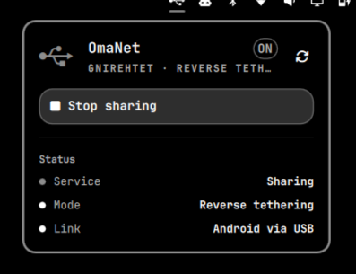

# OmaNet

Share your laptop's internet connection with an Android phone over USB.



OmaNet is a lightweight Linux utility and [Omarchy](https://omarchy.org/) bar
plugin that runs [GNirehtet](https://github.com/Genymobile/gnirehtet) as a
user-level systemd service. It is the opposite of normal Android USB tethering:
instead of sharing the phone's connection with the computer, it shares the
computer's connection with the phone.

## Quick start

```bash
omarchy plugin add https://github.com/MrUranium1/Omanet.git --enable
```

Then click the **OmaNet** icon in the bar. If GNirehtet (or the service) is not
installed yet, the icon shows a warning colour and clicking it opens a terminal
that installs everything it needs. Once it is ready, click again to start
sharing. Connect your phone, enable USB debugging, and approve the prompts (see
[Android setup](#android-setup)).

Prefer the command line? The same installer can be run directly:

```bash
./install.sh            # installs GNirehtet if needed, plus the CLI and service
usb-internet-share start
```

## Features

- Start, stop, and check USB internet sharing.
- Run GNirehtet through a user-level systemd service.
- Control sharing from the terminal, the Omarchy bar, or a desktop launcher.
- No `sudo` needed for normal start/stop after setup.

## Requirements

- Linux with Bash and a working **user-level** systemd manager.
- An Android phone with USB debugging enabled.
- A USB data cable.
- [ADB](https://developer.android.com/tools/adb) installed, with the phone authorized.
- [GNirehtet](https://github.com/Genymobile/gnirehtet) available as the `gnirehtet` command.

On Arch Linux, GNirehtet ships in the AUR as `gnirehtet-bin`.

## Installation

Clone or download this repository, then run the installer as your normal user,
without `sudo`:

```bash
./install.sh
```

The installer:

- checks for GNirehtet and ADB and offers to install any that are missing
  (see [Dependencies](#dependencies));
- installs the `usb-internet-share` and `usb-internet-share-menu` commands into
  `~/.local/bin`;
- installs the user-level unit `~/.config/systemd/user/usb-internet-share.service`;
- adds a desktop launcher (`~/.local/share/applications/usb-internet-share.desktop`).

If it stops for any reason, no files are written.

Make sure `~/.local/bin` is in your `PATH`.

OmaNet is distributed as a source checkout — there is no separate release
archive. Keep the repository layout intact (in particular
`scripts/install-dependencies.sh`), because `install.sh` invokes that script
relative to its own location. The installer can be run from any working
directory.

### Dependencies

The installer runs `scripts/install-dependencies.sh`, which checks for GNirehtet
and ADB. If either is missing it detects your package manager (pacman, apt-get,
dnf, zypper, apk, or brew) and **asks before installing anything** — nothing is
ever installed silently.

- ADB is installed from your distribution's packages (`android-tools` or `adb`).
- GNirehtet is only available automatically on Arch Linux, through the AUR
  package `gnirehtet-bin` (using `yay` or `paru` if present). Elsewhere, install
  it manually.

If you decline, no supported package manager is found, or an install fails, the
installer stops and prints the exact remaining steps. You can also run the check
on its own:

```bash
./scripts/install-dependencies.sh
```

Pass `--yes` to skip the prompt for unattended installs.

### Omarchy bar plugin

The bar widget is provided by `manifest.json`, `Service.qml`, and
`BarWidget.qml`. Add it with:

```bash
omarchy plugin add https://github.com/MrUranium1/Omanet.git --enable
```

`omarchy plugin add` only clones and enables the plugin — it cannot run an
installer — so the widget checks its dependencies itself when it loads. If
GNirehtet is missing, or the `usb-internet-share.service` has not been
installed, the bar icon switches to a setup state (an exclamation marker in the
warning colour). Clicking it opens a terminal that runs the installer, which
installs GNirehtet if needed and sets up the CLI and service. No manual
`./install.sh` is required.

To remove it:

```bash
omarchy plugin remove mehir.usb-internet-share
```

## Android setup

1. On the phone, enable **Developer options** (tap **Build number** seven times in
   **Settings › About phone**).
2. Enable **USB debugging** in **Developer options**.
3. Connect the phone with a USB **data** cable and unlock it.
4. Set the USB mode to **File transfer / MTP** (not "Charging only").
5. Approve the **Allow USB debugging** prompt, and tick **Always allow from this
   computer** so it persists.
6. **Disable any other active VPN** on the phone — GNirehtet installs its own VPN
   and cannot run alongside one.
7. Start sharing with `usb-internet-share start`, the desktop launcher, or the bar
   widget.
8. When Android asks to allow a VPN connection, approve it. A persistent VPN key
   notification appears while sharing; this is expected.

Keep USB debugging enabled while using GNirehtet.

## Usage

### Omarchy bar widget

- **Left-click** the icon to open the status panel.
- **Right-click** to start or stop sharing.
- In the panel, use the action button to start/stop, the refresh button to
  re-check the service, and the **Status** rows to see the service state, mode,
  and link.

The icon is bright while sharing and dimmed otherwise.

### Command line

Start sharing:

```bash
usb-internet-share start
```

Stop sharing:

```bash
usb-internet-share stop
```

Check service status:

```bash
usb-internet-share status
```

Open the terminal menu (also used by the desktop launcher):

```bash
usb-internet-share-menu
```

### Optional Hyprland keybind

`packaging/hyprland-bindings.conf` contains a ready-made binding
(`SUPER SHIFT, T`) that opens the terminal menu. Add it to your user Hyprland
config and reload — but check that the combination is not already taken by
Omarchy's default bindings and pick another if it is.

## Troubleshooting

- **`gnirehtet: command not found`** — install GNirehtet (see
  [Dependencies](#dependencies)).
- **Phone not detected / `adb devices` shows `unauthorized`** — unlock the phone
  and re-approve the USB debugging prompt; try a different cable or port.
- **Sharing starts but the phone has no internet** — make sure no other VPN is
  active on the phone, then stop and start sharing again.
- **Service fails to start** — inspect it with
  `systemctl --user status usb-internet-share.service`.

## Uninstallation

Run the following from the project directory:

```bash
./uninstall.sh
```

This stops sharing and removes the installed utility, desktop launcher, and
user-level service. GNirehtet itself is not uninstalled.

If you installed the Omarchy plugin, remove it as well:

```bash
omarchy plugin remove mehir.usb-internet-share
```

## Limitations

- Android USB debugging and ADB authorization are required.
- Android may display a persistent VPN notification while sharing.
- The project depends on GNirehtet and a working user-level systemd manager.
- The Omarchy widget requires the utility and service to be installed first.

## License

MIT — see [LICENSE](LICENSE). OmaNet bundles no third-party binaries; ADB and
GNirehtet are installed separately from your package manager and remain under
their own licenses (both Apache-2.0).
